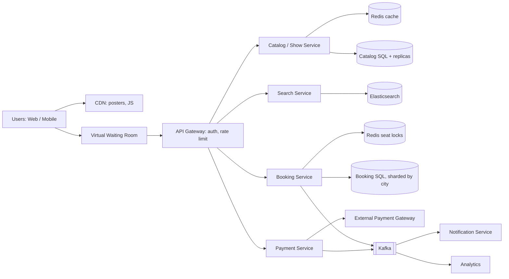

# 90-Day Plan: DSA + System Design (Day by Day)

**Daily time:** about 3 hours. DSA takes 2 hours (2 to 3 problems) and System Design (SD) takes 1 hour.
**Revision days:** Days 7, 14, 21, ... 84 are revision and mock days. If you start on a **Monday**, they always fall on a Sunday.
**Language for DSA:** JavaScript. Problem names are LeetCode titles. If a problem is LeetCode Premium, solve it free on [NeetCode](https://neetcode.io/practice) or [LintCode](https://www.lintcode.com).

| Days | DSA phase | System Design phase |
|---|---|---|
| 1 to 28 | Foundations: arrays, strings, two pointers, sliding window, binary search, linked lists | Fundamentals, with a real-world example for every concept |
| 29 to 56 | Core: stacks, trees, BST, heaps, tries, backtracking, graphs | Fundamentals wrap-up + case studies: URL shortener, rate limiter, **movie ticketing**, notifications, WhatsApp, Instagram, YouTube, autocomplete, web crawler |
| 57 to 84 | Advanced: graphs, dynamic programming, greedy, intervals, bits, hard problems | Case studies: Uber, Swiggy, Google Docs, Dropbox, Amazon flash sale, payments, Airbnb, key-value store, leaderboard, scheduler, metrics, trending, stock exchange, Hotstar live, frontend design |
| 85 to 90 | Timed mock interviews | Timed mock interviews |

---

## Before Day 1: Read These Once

### How to solve every DSA problem
1. Repeat the problem in your own words. Write 2 examples and 1 edge case (empty input, a single element, duplicates, negatives).
2. Say the brute-force approach and its time complexity out loud.
3. Ask "which pattern is this?" using the table below.
4. Code it with clean names, talking as you type.
5. Dry-run your example by hand, then state the time and space complexity.
6. **Rule of 25 minutes:** if you're stuck, read the solution, understand it, and re-solve it from scratch on the next revision day.

| If the problem says... | Try... |
|---|---|
| Sorted array, "find a pair / target" | Two pointers / binary search |
| Longest or shortest subarray/substring | Sliding window |
| "Subarray sum equals K" | Prefix sum + hash map |
| "Have I seen this before?", counting | Hash map / Set |
| "Minimum value that works" | Binary search on the answer |
| Next greater / previous smaller | Monotonic stack |
| Top K / Kth largest | Heap |
| All combinations / subsets / permutations | Backtracking |
| Shortest path, unweighted | BFS |
| Shortest path, weighted | Dijkstra |
| Dependencies / ordering | Topological sort |
| Connected groups | Union Find / DFS |
| "Number of ways", min/max with choices | Dynamic programming |
| Intervals | Sort by start, then merge |

### JavaScript syntax for DSA
```js
const map = new Map();
map.set(key, (map.get(key) || 0) + 1);   // frequency count
const set = new Set(); set.add(x); set.has(x);

nums.sort((a, b) => a - b);              // ALWAYS pass a comparator for numbers
const grid = Array.from({ length: rows }, () => Array(cols).fill(0)); // 2D array

const stack = []; stack.push(x); stack.pop(); stack[stack.length - 1]; // peek
const queue = [x]; let head = 0; const item = queue[head++];           // fast queue (shift() is O(n))

s.charCodeAt(i) - 97;   // 'a' -> 0
Math.floor((lo + hi) / 2);
```

### The 4-step SD interview framework (use it in every case study)
1. **Requirements (5 min):** functional (what it does) and non-functional (scale, latency, consistency, availability).
2. **Estimation + API (5 min):** daily users, requests per second (QPS), storage, main endpoints.
3. **High-level design (15 min):** client, load balancer, services, databases, cache, queues.
4. **Deep dive (15 min):** bottlenecks, scaling, failure cases, trade-offs.

### What a revision day looks like
- **DSA (2 hrs):** re-solve the listed problems **without looking at your old code**, then do 1 timed mock (2 problems in 60 minutes).
- **SD (1 hr):** draw the week's designs from memory on paper, then check them against your notes.

---

# MONTH 1: Foundations

## Week 1: Arrays, Hashing | SD: Basics

### Day 1: Big-O + Arrays | SD: How the web works
- [ ] **DSA:** Learn Big-O (O(1), O(log n), O(n), O(n log n), O(n²)) and space complexity. Solve: Two Sum, Contains Duplicate, Valid Anagram
- [ ] **SD:** Client-server model, DNS, IP, HTTP vs HTTPS, TCP vs UDP.
  - *Example:* what happens when you type `bookmyshow.com` and press Enter: DNS lookup, TCP + TLS handshake, HTTP request, server response, browser render.

### Day 2: Array traversal | SD: REST API design
- [ ] **DSA:** Solve: Best Time to Buy and Sell Stock, Move Zeroes, Remove Duplicates from Sorted Array
- [ ] **SD:** REST resources, HTTP methods, status codes (200/201/400/401/404/429/500), pagination (offset vs cursor), versioning (`/v1/`).
  - *Example:* APIs for Instagram: `POST /posts`, `GET /users/{id}/feed?cursor=abc&limit=20`, `POST /posts/{id}/like`. Feeds use a cursor rather than an offset, because new posts shift offsets.

### Day 3: Kadane + running sums | SD: Requirements gathering
- [ ] **DSA:** Learn Kadane's algorithm. Solve: Maximum Subarray, Plus One, Running Sum of 1d Array
- [ ] **SD:** Functional vs non-functional requirements, and which questions to ask the interviewer.
  - *Example:* URL shortener. Functional: shorten a URL, redirect, optional custom alias and expiry. Non-functional: very fast redirects (under 100 ms), highly available, short links must not be guessable.

### Day 4: In-place array tricks | SD: Back-of-the-envelope estimation
- [ ] **DSA:** Solve: Rotate Array, Merge Sorted Array, Majority Element (Boyer-Moore voting)
- [ ] **SD:** Powers of 2 (KB/MB/GB/TB), latency numbers (memory ~100 ns, SSD ~100 µs, network round trip ~150 ms), QPS = daily requests / 86,400, peak = 2 to 3 times average.
  - *Example:* Twitter with 300M daily users, each posting 2 tweets/day: 600M / 86,400 ≈ **7K writes/sec**, peak about 15K/sec. At 300 bytes per tweet, that's about 180 GB/day and **about 65 TB/year** for text alone.

### Day 5: Hashing | SD: SQL vs NoSQL
- [ ] **DSA:** Learn frequency maps and bucket sort. Solve: Group Anagrams, Top K Frequent Elements, First Unique Character in a String
- [ ] **SD:** Relational databases (ACID, joins, schema) vs NoSQL types: key-value (Redis), document (MongoDB), wide-column (Cassandra), graph (Neo4j). Also ACID vs BASE.
  - *Example:* in Amazon, **orders and payments** go in SQL (they need transactions), the **product catalog** in a document DB (every product has different fields), and **chat messages** in Cassandra (huge write volume).

### Day 6: Hashing 2 | SD: Indexes, normalization
- [ ] **DSA:** Solve: Product of Array Except Self, Longest Consecutive Sequence, Valid Sudoku
- [ ] **SD:** B-tree indexes, composite indexes, the cost of indexes on writes, normalization vs denormalization.
  - *Example:* the "My Orders" page on Amazon is slow. Add an index on `(user_id, created_at DESC)`. Store `product_name` inside the order row (denormalized) so the page needs no join.

### Day 7: REVISION
- [ ] **DSA:** Re-solve Two Sum, Best Time to Buy and Sell Stock, Maximum Subarray, Group Anagrams, Top K Frequent Elements, Product of Array Except Self. Mock: Longest Consecutive Sequence + Majority Element in 60 min.
- [ ] **SD:** Redo the estimation for WhatsApp (2B users, 40 messages/day each): messages/sec and storage per year. Write one-page notes on SQL vs NoSQL.

## Week 2: Strings, Two Pointers, Sliding Window | SD: Scaling

### Day 8: Strings | SD: Vertical vs horizontal scaling
- [ ] **DSA:** Solve: Valid Palindrome, Longest Common Prefix, Isomorphic Strings
- [ ] **SD:** Vertical scaling (a bigger machine, with a ceiling) vs horizontal scaling (more machines). Stateless servers. Single point of failure.
  - *Example:* Swiggy at 1 PM lunch rush. One big server will eventually max out, while 50 small stateless servers can grow to 200. Sessions must live in Redis, not in a server's memory.

### Day 9: Two pointers (opposite ends) | SD: Load balancers
- [ ] **DSA:** Learn the two-pointer pattern. Solve: Two Sum II, Reverse String, Squares of a Sorted Array
- [ ] **SD:** L4 vs L7 load balancers, algorithms (round robin, least connections, IP hash), health checks, sticky sessions, and having two load balancers so the balancer isn't a single point of failure.
  - *Example:* Netflix. An L7 load balancer routes `/api/search` to the search servers and `/api/play` to playback servers, and drops unhealthy servers using health checks.

### Day 10: Two pointers medium | SD: Caching 1
- [ ] **DSA:** Solve: 3Sum, Container With Most Water, Sort Colors
- [ ] **SD:** Cache-aside, write-through, write-back, TTL, eviction (LRU, LFU).
  - *Example:* an Amazon product page. Cache-aside in Redis with a 10-minute TTL, because product details rarely change. The **price and stock** come from the database or use a very short TTL.

### Day 11: Two pointers hard | SD: Caching 2
- [ ] **DSA:** Solve: Trapping Rain Water, Reverse Words in a String, String Compression
- [ ] **SD:** Cache invalidation, cache stampede (thundering herd), hot keys, Redis vs Memcached.
  - *Example:* a live IPL score page read by 20M people. When its cache key expires, millions of requests hit the database at once. Fix it with a lock so only one request refills the cache, refresh before expiry, and copy the hot key to multiple Redis nodes.

### Day 12: Sliding window (fixed size) | SD: CDN
- [ ] **DSA:** Learn the sliding window. Solve: Maximum Average Subarray I, Contains Duplicate II, Find All Anagrams in a String
- [ ] **SD:** CDN, edge locations, push vs pull CDN, `Cache-Control` headers, cache busting with file hashes.
  - *Example:* YouTube thumbnails and React JS bundles are served from a CDN in Mumbai instead of a US server, so latency drops from 250 ms to 20 ms.

### Day 13: Sliding window (variable size) | SD: Proxies + API gateway
- [ ] **DSA:** Solve: Longest Substring Without Repeating Characters, Minimum Size Subarray Sum, Longest Repeating Character Replacement
- [ ] **SD:** Forward vs reverse proxy (Nginx), and an API gateway that handles auth, rate limiting, routing, and SSL termination.
  - *Example:* Uber's mobile app calls one gateway, which checks the JWT and then routes to the Rider, Driver, or Payment service.

### Day 14: REVISION
- [ ] **DSA:** Re-solve 3Sum, Container With Most Water, Trapping Rain Water, Longest Substring Without Repeating Characters, Longest Repeating Character Replacement, Find All Anagrams in a String. Mock: Minimum Size Subarray Sum + Sort Colors in 60 min.
- [ ] **SD:** Draw the "1 user to 1 million users" journey: single server, separate DB, load balancer + multiple servers, cache, CDN, DB replicas.

## Week 3: Prefix Sum, Recursion, Sorting, Binary Search | SD: Databases at scale

### Day 15: Sliding window hard | SD: Replication
- [ ] **DSA:** Solve: Permutation in String, Subarray Sum Equals K, Minimum Window Substring
- [ ] **SD:** Leader-follower, multi-leader, and leaderless replication. Replication lag, "read your own writes", failover.
  - *Example:* you update your Instagram bio, refresh, and see the old bio because the read went to a lagging replica. Fix: read your *own* profile from the leader for 1 minute after editing it.

### Day 16: Prefix sum | SD: Sharding
- [ ] **DSA:** Learn prefix sums. Solve: Range Sum Query - Immutable, Find Pivot Index, Continuous Subarray Sum
- [ ] **SD:** Range vs hash vs directory sharding, choosing a shard key, hot shards, resharding, why cross-shard joins are hard.
  - *Example:* Instagram shards photos by `user_id`, so all of one user's photos sit on one shard. *Problem:* a celebrity with 600M followers makes their shard hot.

### Day 17: Recursion basics | SD: Consistent hashing
- [ ] **DSA:** Learn base cases, the call stack, recursion trees. Solve: Fibonacci Number, Pow(x, n), Power of Two (recursively)
- [ ] **SD:** Why `hash(key) % N` breaks when N changes, the hash ring, virtual nodes.
  - *Example:* a Redis cache cluster growing from 4 to 5 nodes. With modulo hashing, about 80% of keys move and the cache misses spike. With consistent hashing, only about 20% move.

### Day 18: Sorting | SD: CAP theorem + consistency models
- [ ] **DSA:** Write merge sort and quick sort by hand. Solve: Sort an Array (with merge sort), Sort an Array (with quick sort), Largest Number
- [ ] **SD:** CAP theorem (when the network splits, choose consistency or availability), PACELC, and strong vs eventual vs causal consistency.
  - *Example:* a **bank balance** must be CP (consistent). The **like count** on a post can be AP (eventually consistent), since showing 1,203 instead of 1,205 likes is fine.

### Day 19: Binary search | SD: Transactions + locking
- [ ] **DSA:** Learn the binary search template. Solve: Binary Search, Search Insert Position, Sqrt(x)
- [ ] **SD:** Isolation levels, race conditions, pessimistic locks (`SELECT ... FOR UPDATE`) vs optimistic locks (version column).
  - *Example:* one iPhone left in stock and two buyers click "Buy" together. With optimistic locking, `UPDATE stock SET qty = qty - 1 WHERE id = 1 AND qty > 0`, so only one row update succeeds.

### Day 20: Binary search 2 | SD: Message queues + Kafka
- [ ] **DSA:** Solve: Find First and Last Position of Element in Sorted Array, Search a 2D Matrix, Find Peak Element
- [ ] **SD:** Point-to-point queues vs pub/sub. Kafka basics: topics, partitions, offsets, consumer groups. At-most-once, at-least-once, and exactly-once delivery.
  - *Example:* a Swiggy order is placed and an `OrderPlaced` event goes to Kafka. The restaurant service, delivery-assignment service, notification service, and analytics each consume it independently.

### Day 21: REVISION
- [ ] **DSA:** Re-solve Subarray Sum Equals K, Minimum Window Substring, Continuous Subarray Sum, Sort an Array (merge sort), Find First and Last Position, Find Peak Element. Mock: Permutation in String + Search a 2D Matrix in 60 min.
- [ ] **SD:** For each of replication, sharding, consistent hashing, CAP, and locking, write 3 lines: the problem it solves, how it works, and the trade-off.

## Week 4: Advanced Binary Search, Linked Lists | SD: Reliability patterns

### Day 22: Rotated arrays | SD: Idempotency + retries
- [ ] **DSA:** Solve: Search in Rotated Sorted Array, Find Minimum in Rotated Sorted Array, Single Element in a Sorted Array
- [ ] **SD:** Idempotency keys, retries with exponential backoff and jitter, dead-letter queues.
  - *Example:* in Razorpay or Stripe, the user double-clicks "Pay" or the network retries. The client sends `Idempotency-Key: order_123`, and the server stores it and returns the same result instead of charging twice.

### Day 23: Binary search on the answer | SD: Distributed transactions
- [ ] **DSA:** Solve: Koko Eating Bananas, Capacity To Ship Packages Within D Days, Split Array Largest Sum
- [ ] **SD:** Two-phase commit (and why it's avoided), the Saga pattern (each step has an undo), the Outbox pattern.
  - *Example:* MakeMyTrip books a flight and then a hotel. If the hotel booking fails, the saga runs the undo step and cancels the flight. The Outbox pattern guarantees the "BookingCreated" event is never lost.

### Day 24: Linked list basics | SD: Rate limiting
- [ ] **DSA:** Build a `ListNode` class and learn the dummy-node trick. Solve: Reverse Linked List, Merge Two Sorted Lists, Middle of the Linked List
- [ ] **SD:** Token bucket, leaky bucket, fixed window, sliding window log, sliding window counter.
  - *Example:* OTP SMS limited to 3 per phone number per 10 minutes, to stop SMS-cost abuse. GitHub's API allows 5,000 requests/hour and returns `429 Too Many Requests` beyond that.

### Day 25: Fast and slow pointers | SD: Real-time communication
- [ ] **DSA:** Solve: Linked List Cycle, Linked List Cycle II, Remove Nth Node From End of List
- [ ] **SD:** Short polling, long polling, WebSockets, Server-Sent Events, webhooks. When to use each.
  - *Example:* a **cricket score** uses Server-Sent Events (server to client only), a **chat** uses WebSockets (both directions), a **payment status** from Razorpay uses a webhook (server to server), and a **dashboard refresh** can use polling.

### Day 26: Linked list medium | SD: Object storage + file uploads
- [ ] **DSA:** Solve: Palindrome Linked List, Intersection of Two Linked Lists, Add Two Numbers
- [ ] **SD:** Blob storage (S3), presigned URLs, chunked and resumable uploads, metadata in a DB with files in S3.
  - *Example:* uploading an Instagram photo. The app gets a presigned S3 URL from the backend and uploads **directly to S3**, so the backend never handles the large file. Then a "photo uploaded" event triggers thumbnail generation.

### Day 27: Linked list hard | SD: Search systems
- [ ] **DSA:** Solve: Reorder List, Copy List with Random Pointer, LRU Cache
- [ ] **SD:** Inverted index, tokenization, relevance ranking, Elasticsearch, keeping search in sync with the DB using change data capture (CDC).
  - *Example:* Amazon search for "red running shoes under 2000". The inverted index maps each word to product IDs, filters handle price, and Elasticsearch is kept in sync with the product DB through Kafka.

### Day 28: REVISION (end of Month 1)
- [ ] **DSA:** Re-solve Search in Rotated Sorted Array, Koko Eating Bananas, Split Array Largest Sum, Reverse Linked List, Linked List Cycle II, Reorder List, LRU Cache. Mock: Copy List with Random Pointer + Capacity To Ship Packages in 60 min.
- [ ] **SD:** Write a cheat sheet with one line each: idempotency, saga, outbox, the rate-limit algorithms, WebSocket vs SSE vs polling, presigned URLs, inverted index.
- **Checkpoint:** easy problems in under 15 minutes, and you can explain all the SD building blocks so far without notes.

---

# MONTH 2: Core Data Structures + Case Studies

## Week 5: Stacks, Queues, Tree Basics | SD: Last fundamentals + first case studies

### Day 29: Stacks | SD: Microservices
- [ ] **DSA:** Solve: Valid Parentheses, Min Stack, Implement Queue using Stacks
- [ ] **SD:** Monolith vs microservices, database-per-service, service discovery, REST vs gRPC, circuit breaker, bulkhead.
  - *Example:* Netflix has hundreds of services. If the recommendation service is down, a circuit breaker returns a default "Popular on Netflix" row instead of failing the whole home page.

### Day 30: Monotonic stack | SD: Reliability, observability, security
- [ ] **DSA:** Learn the monotonic stack. Solve: Evaluate Reverse Polish Notation, Daily Temperatures, Next Greater Element I
- [ ] **SD:** Redundancy across availability zones and regions, failover, backups, disaster recovery (RPO/RTO), SLA/SLO/SLI. Metrics, logs, and distributed traces. Security: HTTPS, OAuth 2.0, JWT, encryption at rest.
  - *Example:* when an AWS region goes down, Hotstar fails over to another region, using health checks plus DNS failover. A trace ID shows that a slow request spent 2 seconds waiting on the payment service.

### Day 31: Hard stacks | SD: Case study 1, URL Shortener (part 1 of 2)
- [ ] **DSA:** Solve: Largest Rectangle in Histogram, Car Fleet, Sliding Window Maximum (with a deque)
- [ ] **SD:** Requirements, estimation (100M new URLs/month, a 100:1 read-to-write ratio), API (`POST /urls`, `GET /{code}` with a 302 redirect).
  - **How to generate the short code:** a hash of the URL (MD5, take 7 characters, but collisions happen) vs a counter + base62 (`62^7 ≈ 3.5 trillion` codes) vs a Key Generation Service that pre-creates codes.
  - The counter is a single point of failure. Fix it by giving each server a range of counters (server A gets 1 to 1M, server B gets 1M to 2M).

### Day 32: Tree traversals | SD: URL Shortener (part 2 of 2)
- [ ] **DSA:** Learn preorder, inorder, and postorder traversal, both recursive and iterative. Solve: Binary Tree Inorder Traversal, Binary Tree Preorder Traversal, Binary Tree Postorder Traversal
- [ ] **SD:** DB choice (a key-value store such as DynamoDB, since it's just a code-to-URL lookup), caching popular codes in Redis (about 20% of links get 80% of traffic), 301 (permanent, cached by the browser, so you lose analytics) vs 302 (temporary, so you can count clicks), click analytics through Kafka, expiry with a cleanup job.

### Day 33: Tree depth | SD: Case study 2, Distributed Rate Limiter
- [ ] **DSA:** Solve: Maximum Depth of Binary Tree, Invert Binary Tree, Same Tree
- [ ] **SD:** Where to put it (API gateway vs middleware), storing counters in Redis, making check-and-increment atomic with a Lua script or `INCR` + `EXPIRE`, rules per user/IP/API, response headers (`X-RateLimit-Remaining`), what to do if Redis is down (allow requests through or block them).

### Day 34: Tree properties | SD: Case study 3, Unique ID Generator
- [ ] **DSA:** Solve: Symmetric Tree, Subtree of Another Tree, Balanced Binary Tree
- [ ] **SD:** Auto-increment (doesn't work across shards), UUID (128-bit, not sortable, bad for indexes), a ticket server, **Twitter Snowflake** (64 bits = timestamp + machine ID + sequence, sortable by time, generated without coordination).
  - *Example:* tweet IDs and order IDs at Flipkart, generated on thousands of servers with no collisions.

### Day 35: REVISION
- [ ] **DSA:** Re-solve Min Stack, Daily Temperatures, Largest Rectangle in Histogram, Sliding Window Maximum, iterative Inorder Traversal, Balanced Binary Tree. Mock: Car Fleet + Subtree of Another Tree in 60 min.
- [ ] **SD:** Draw the URL shortener and the rate limiter from memory in 20 minutes each.

## Week 6: Trees + BST | SD: Movie Ticketing System (BookMyShow) + Notifications

### Day 36: Tree BFS | SD: BookMyShow 1 of 5, requirements, API, data model
- [ ] **DSA:** Learn level-order BFS. Solve: Diameter of Binary Tree, Binary Tree Level Order Traversal, Binary Tree Right Side View
- [ ] **SD:**
  - *Functional:* browse movies by city, see shows and theatres, view the seat map, select seats, pay, get the ticket.
  - *Non-functional:* **no double booking** (strong consistency), fast and highly available browsing (stale is OK), surviving blockbuster spikes.
  - *Estimation:* 20M daily users, 1M bookings/day ≈ 12 bookings/sec on average and about 1,200/sec at peak. Reads are about 100 times writes.
  - *API:* `GET /cities/{id}/movies`, `GET /movies/{id}/shows`, `GET /shows/{id}/seats`, `POST /bookings/hold`, `POST /bookings/{id}/pay`
  - *Tables:* City, Cinema, Screen, Seat (the physical chair), Movie, Show, **ShowSeat (show_id, seat_id, status, booking_id, version, hold_expires_at)**, Booking, Payment, User. Seat status lives on ShowSeat, not Seat.

### Day 37: Tree BFS 2 | SD: BookMyShow 2 of 5, the browse path
- [ ] **DSA:** Solve: Binary Tree Zigzag Level Order Traversal, Average of Levels in Binary Tree, Count Good Nodes in Binary Tree
- [ ] **SD:** Movies per city and showtimes cached in Redis (10-minute TTL), posters on a CDN, browse reads go to **read replicas**, movie and actor search uses Elasticsearch. Seat availability is **not** cached long, since the DB is the source of truth.

### Day 38: Tree paths | SD: BookMyShow 3 of 5, preventing double booking
- [ ] **DSA:** Solve: Path Sum, Path Sum II, Lowest Common Ancestor of a Binary Tree
- [ ] **SD:** Alice and Bob click seat A5 at the same millisecond.
  - **Pessimistic:** `SELECT ... FOR UPDATE` on the ShowSeat rows. Correct, but slow under contention.
  - **Optimistic:** `UPDATE ShowSeat SET status='HELD', version=version+1 WHERE show_id=1 AND seat_id=5 AND status='AVAILABLE' AND version=3`. If 0 rows are updated, show "seat taken".
  - **Redis lock:** `SET seat:1:A5 alice NX PX 600000` for a fast 10-minute hold.
  - **Seat hold flow:** AVAILABLE, then HELD (10 minutes), then BOOKED on payment, or back to AVAILABLE when a background job finds an expired hold.
  - CAP: booking is CP, browsing is AP.

### Day 39: BST basics | SD: BookMyShow 4 of 5, payments + notifications
- [ ] **DSA:** Learn the BST property (inorder traversal is sorted). Solve: Validate Binary Search Tree, Kth Smallest Element in a BST, Lowest Common Ancestor of a Binary Search Tree
- [ ] **SD:** An idempotency key on the payment, a saga (hold seats, then charge, then confirm, undoing in reverse on failure), the payment gateway webhook, and timeouts (don't assume failure; poll the gateway's status API). Confirming the booking + writing an outbox row happen in one transaction, then a Kafka event drives the email/SMS ticket, analytics, and loyalty points.

### Day 40: BST operations | SD: BookMyShow 5 of 5, blockbuster launch day
- [ ] **DSA:** Solve: Insert into a Binary Search Tree, Delete Node in a BST, Convert Sorted Array to Binary Search Tree
- [ ] **SD:** 5M users at 12:00 for a big movie release:
  - A **virtual waiting room** ("You are #45,210 in line") lets in N users/sec.
  - Rate limiting per user at the gateway.
  - Pre-scaling servers before the known launch time.
  - Sharding the booking DB by `city_id` (or `show_id` for very large cities).
  - A circuit breaker on payments.
  - A live seat map using Server-Sent Events or 3-second polling.
  - Turning off recommendations during the spike.
  - Draw the final diagram (see the end of this file).

### Day 41: Hard trees | SD: Case study 5, Notification System
- [ ] **DSA:** Solve: Construct Binary Tree from Preorder and Inorder Traversal, Binary Tree Maximum Path Sum, Serialize and Deserialize Binary Tree
- [ ] **SD:** Channels (push via APNs/FCM, SMS, email), a separate queue per channel, priority queues (an OTP goes before a promo), templates, user preferences and opt-out, retries + dead-letter queue, de-duplication, rate limiting per user (no spamming).
  - *Example:* the Swiggy "order out for delivery" push, and Diwali sale emails sent to 50M users.

### Day 42: REVISION
- [ ] **DSA:** Re-solve Level Order Traversal, Right Side View, LCA of a Binary Tree, Validate BST, Delete Node in a BST, Construct Binary Tree from Preorder and Inorder, Serialize and Deserialize Binary Tree. Mock: Binary Tree Maximum Path Sum + Kth Smallest in a BST in 60 min.
- [ ] **SD:** Explain BookMyShow **out loud in 40 minutes** using the 4-step framework. Record yourself.

## Week 7: Heaps, Tries, Backtracking | SD: WhatsApp + Instagram

### Day 43: Heaps | SD: WhatsApp 1 of 3, connections + 1:1 messaging
- [ ] **DSA:** Write a `MinHeap` class (push, pop, bubble up/down). Solve: Kth Largest Element in a Stream, Last Stone Weight, Kth Largest Element in an Array
- [ ] **SD:** Requirements (1:1 chat, groups, online status, read receipts, media). Each user holds a **WebSocket** to a chat server. A session service in Redis records which server each user is connected to. Message flow: A's chat server looks up B's server and forwards the message. IDs come from Snowflake so messages are ordered.

### Day 44: Heaps 2 | SD: WhatsApp 2 of 3, storage, offline delivery, receipts
- [ ] **DSA:** Solve: K Closest Points to Origin, Top K Frequent Words, Task Scheduler
- [ ] **SD:** Store messages in Cassandra (partition key = `chat_id`, sorted by `message_id`). If B is offline, keep the message in an inbox and send a push notification. Sent/delivered/read ticks are small acknowledgment messages. Presence comes from a heartbeat every 30 seconds (offline after 60 seconds without one).

### Day 45: Two heaps + design | SD: WhatsApp 3 of 3, groups, media, scale
- [ ] **DSA:** Solve: Merge k Sorted Lists, Find Median from Data Stream, Design Twitter
- [ ] **SD:** Group fan-out (send one copy to each member's server, and cap group size at 1,024 members). Media goes to S3 + CDN, and only a link is sent in the message. End-to-end encryption at a high level. Scaling to 500M connections (about 1M per server means 500+ chat servers).

### Day 46: Trie | SD: Instagram 1 of 3, posting photos
- [ ] **DSA:** Learn the Trie. Solve: Implement Trie (Prefix Tree), Design Add and Search Words Data Structure, Replace Words
- [ ] **SD:** Requirements (post photos, follow, feed, likes, comments). Upload through a presigned URL to S3, with thumbnails generated asynchronously. Data model: User, Post, Follow (follower_id, followee_id), Like, Comment. Posts are sharded by user_id.

### Day 47: Backtracking basics | SD: Instagram 2 of 3, news feed generation
- [ ] **DSA:** Learn the "choose, explore, un-choose" pattern. Solve: Subsets, Subsets II, Permutations
- [ ] **SD:**
  - **Fan-out on write (push):** when a post is created, add it to every follower's feed cache. Reads are fast, but a celebrity with 600M followers is very expensive.
  - **Fan-out on read (pull):** build the feed when the user opens the app. Writes are cheap, but reads are slow.
  - **Hybrid (what Instagram and Twitter do):** push for normal users, pull for celebrities, and merge at read time. The feed cache in Redis holds a list of post IDs per user.

### Day 48: Backtracking 2 | SD: Instagram 3 of 3, likes, counters, trending
- [ ] **DSA:** Solve: Combination Sum, Combination Sum II, Permutations II
- [ ] **SD:** Like counters (don't run `COUNT(*)` on every read; keep a counter in Redis and flush it to the DB in batches), cursor-based feed pagination, hashtag search with an inverted index, trending hashtags using counts per 5-minute window.

### Day 49: REVISION
- [ ] **DSA:** Re-solve Kth Largest Element in an Array (with a heap), Task Scheduler, Merge k Sorted Lists, Find Median from Data Stream, Implement Trie, Subsets II, Combination Sum II. Mock: Top K Frequent Words + Permutations II in 60 min.
- [ ] **SD:** Draw WhatsApp and Instagram from memory. Compare them: what's similar (WebSockets, fan-out, Cassandra) and what's different.

## Week 8: Backtracking, Graphs | SD: YouTube, Autocomplete, Web Crawler

### Day 50: Backtracking 3 | SD: YouTube 1 of 3, video upload pipeline
- [ ] **DSA:** Solve: Letter Combinations of a Phone Number, Generate Parentheses, Palindrome Partitioning
- [ ] **SD:** Requirements (upload, watch, search, comments). Resumable chunked upload to S3, then a "video uploaded" event in a queue. **Transcoding workers** convert the video to 240p/480p/720p/1080p in parallel (a pipeline of steps), and the metadata DB is updated when they finish.

### Day 51: Backtracking hard | SD: YouTube 2 of 3, streaming at scale
- [ ] **DSA:** Solve: Word Search, N-Queens, Word Search II
- [ ] **SD:** Adaptive bitrate streaming (HLS/DASH): the video is split into 4-second segments, and the player switches quality based on bandwidth. CDNs serve the popular videos, and Netflix's Open Connect boxes sit inside ISPs. Rarely watched videos stay in origin storage.

### Day 52: Graph intro | SD: YouTube 3 of 3, views, comments, cost
- [ ] **DSA:** Learn adjacency lists and BFS/DFS on grids. Solve: Flood Fill, Number of Islands, Max Area of Island
- [ ] **SD:** View counting (batch counts through Kafka rather than writing to the DB on every view), comments sharded by video_id, recommendations at a high level (an offline ML pipeline writes results to a cache), and cost savings (cheaper storage tiers for old videos).

### Day 53: Graph BFS | SD: Search Autocomplete 1 of 2
- [ ] **DSA:** Solve: Clone Graph, Rotting Oranges, 01 Matrix
- [ ] **SD:** Google typeahead. A **trie where each node stores its top 5 suggestions**, so a lookup is O(prefix length). Building it: search logs, then an aggregation job, then a weekly trie rebuild. Serving: the trie lives in memory on the suggestion servers.

### Day 54: Graph DFS | SD: Search Autocomplete 2 of 2
- [ ] **DSA:** Solve: Pacific Atlantic Water Flow, Surrounded Regions, Number of Provinces
- [ ] **SD:** Shard the trie by first letter (and handle uneven letters like "s"), cache responses in the browser and CDN, and on the **frontend** debounce input by 300 ms and cancel stale requests with `AbortController`. That frontend part is directly useful for React interviews. Filter offensive suggestions.

### Day 55: Topological sort | SD: Case study, Web Crawler
- [ ] **DSA:** Learn Kahn's algorithm. Solve: Course Schedule, Course Schedule II, Find Eventual Safe States
- [ ] **SD:** BFS over the web. A URL frontier queue with politeness rules (one request per domain per second), `robots.txt`, DNS caching, de-duplication of URLs with a **Bloom filter**, de-duplication of content with a hash, distributed workers, storing pages in S3.
  - *Example:* Googlebot crawling 1 billion pages a month is about 400 pages/sec.

### Day 56: REVISION (end of Month 2)
- [ ] **DSA:** Re-solve Generate Parentheses, Word Search, N-Queens, Number of Islands, Rotting Oranges, Pacific Atlantic Water Flow, Course Schedule II. Mock: Surrounded Regions + Palindrome Partitioning in 60 min.
- [ ] **SD:** Draw YouTube, autocomplete, and the web crawler. Fill in this table from memory: case study, main challenge, key technique.
- **Checkpoint:** medium tree, graph, and backtracking problems in about 30 minutes, and 8 SD case studies done.

---

# MONTH 3: Advanced + More Case Studies

## Week 9: Advanced Graphs, DP Start | SD: Uber, Swiggy, Google Docs

### Day 57: Union Find | SD: Uber 1 of 3, location updates
- [ ] **DSA:** Write Union Find with path compression. Solve: Redundant Connection, Accounts Merge, Find if Path Exists in Graph
- [ ] **SD:** Requirements (request a ride, match a nearby driver, live tracking, fare, payment). Drivers send their location **every 4 seconds**: 1M active drivers is 250K writes/sec. Store only the latest location in memory (Redis), and put the location history in Kafka for analytics.

### Day 58: BFS shortest path | SD: Uber 2 of 3, finding nearby drivers
- [ ] **DSA:** Solve: Word Ladder, Shortest Path in Binary Matrix, Open the Lock
- [ ] **SD:** Geospatial indexing. **Geohash** (the map is split into a grid, and nearby places share a prefix), **quadtrees** (cells split when they get crowded), Redis `GEOADD`/`GEOSEARCH`, Uber's H3 hexagons. To find drivers within 2 km, search your own cell plus the 8 neighbouring cells.

### Day 59: Dijkstra | SD: Uber 3 of 3, matching + trip lifecycle
- [ ] **DSA:** Learn Dijkstra with a min-heap. Solve: Network Delay Time, Path With Minimum Effort, Swim in Rising Water
- [ ] **SD:** Matching: offer the ride to the nearest driver, and **lock that driver** so they don't get two rides at once (the same problem as the BookMyShow seat lock). Trip state machine: REQUESTED, ACCEPTED, ARRIVED, STARTED, COMPLETED, PAID. Surge pricing comes from the ratio of demand to supply per cell, and ETA from road-graph shortest paths.

### Day 60: Advanced graphs | SD: Swiggy/Zomato 1 of 2, ordering
- [ ] **DSA:** Solve: Cheapest Flights Within K Stops, Min Cost to Connect All Points, Reconstruct Itinerary
- [ ] **SD:** Restaurant search by location (geohash + Elasticsearch filters for cuisine, rating, open now), menu catalog in a document DB + cache, cart, the order service, and the order state machine (PLACED, ACCEPTED, PREPARING, PICKED_UP, DELIVERED). An `OrderPlaced` Kafka event notifies the restaurant tablet.

### Day 61: DP intro | SD: Swiggy/Zomato 2 of 2, delivery + peaks
- [ ] **DSA:** Learn the progression from recursion to memoization to tabulation. Solve: Climbing Stairs, Min Cost Climbing Stairs, N-th Tribonacci Number
- [ ] **SD:** Assigning a delivery partner (a nearby, free partner, using geo search similar to Uber's), live tracking over WebSocket, and lunch and dinner peaks (autoscaling, queues to absorb bursts). Payments and refunds reuse the saga pattern from BookMyShow.

### Day 62: 1D DP | SD: Google Docs (collaborative editing)
- [ ] **DSA:** Solve: House Robber, House Robber II, Coin Change
- [ ] **SD:** Two people typing in the same document at once. **Operational Transformation** (which Google Docs uses) vs **CRDTs** (used by Figma and Notion-style apps), WebSockets for live edits, cursor presence, version history (snapshots + an operation log), offline edits merged later.

### Day 63: REVISION
- [ ] **DSA:** Re-solve Accounts Merge, Word Ladder, Network Delay Time, Cheapest Flights Within K Stops, Min Cost to Connect All Points, Coin Change, House Robber II. Mock: Path With Minimum Effort + Open the Lock in 60 min.
- [ ] **SD:** Draw Uber from memory. Write down how Uber, Swiggy, and BookMyShow all solve the "**two people want the same resource**" problem (a driver, a delivery partner, a seat).

## Week 10: Dynamic Programming | SD: Dropbox, Amazon, Payments

### Day 64: 1D DP 2 | SD: Dropbox/Google Drive 1 of 2, storing files
- [ ] **DSA:** Solve: Coin Change II, Longest Increasing Subsequence, Word Break
- [ ] **SD:** Split files into **4 MB chunks** and store each chunk by its hash, so identical chunks are stored once. Editing 1 line of a 1 GB file uploads only 1 changed chunk. The metadata DB (SQL) maps file to chunk list to versions, and the chunks live in S3.

### Day 65: 1D DP 3 | SD: Dropbox/Google Drive 2 of 2, syncing
- [ ] **DSA:** Solve: Decode Ways, Maximum Product Subarray, Palindromic Substrings
- [ ] **SD:** Syncing across laptop, phone, and web. A notification service uses long polling to say "file changed". Conflict resolution: when two devices edit offline, keep both copies ("file (conflicted copy)"). Also file versioning, sharing permissions, and resumable uploads.

### Day 66: Subset DP | SD: Amazon 1 of 3, catalog, cart, search
- [ ] **DSA:** Solve: Longest Palindromic Substring, Partition Equal Subset Sum, Target Sum
- [ ] **SD:** Product catalog in a document DB + cache, search in Elasticsearch, the cart in Redis for guests and in a DB for logged-in users, product images on a CDN, and recommendations served from precomputed lists.

### Day 67: 2D grid DP | SD: Amazon 2 of 3, checkout + inventory
- [ ] **DSA:** Learn 2D DP tables. Solve: Unique Paths, Unique Paths II, Minimum Path Sum
- [ ] **SD:** Checkout saga: reserve inventory (a **hold with a TTL**, like a BookMyShow seat), then pay, then confirm the order, then notify the warehouse. If payment fails, release the reservation. The order service and the warehouse communicate through events.

### Day 68: String DP | SD: Amazon 3 of 3, flash sale (Big Billion Day)
- [ ] **DSA:** Solve: Longest Common Subsequence, Edit Distance, Best Time to Buy and Sell Stock with Cooldown
- [ ] **SD:** 10,000 phones at 1 rupee, with 5M users at 12:00.
  - Keep the stock counter **in Redis** and use atomic `DECR`; if the result is below 0, it's sold out.
  - Accepted orders go into a queue and are written to the DB slowly.
  - Pre-warm caches, and put static pages on a CDN.
  - Use a waiting room, and block bots with CAPTCHAs and rate limits.
  - **Never oversell:** Redis is the gate, and the DB is the final check.

### Day 69: Hard DP | SD: Payment System (Paytm/Stripe)
- [ ] **DSA:** Solve: Interleaving String, Distinct Subsequences, Longest Increasing Path in a Matrix
- [ ] **SD:** A double-entry **ledger** (every transaction has a debit and a credit that sum to 0, so money is never created or lost), idempotency keys, integrating with payment providers and banks, webhooks, **daily reconciliation** (comparing our records with the bank's), retries, never storing raw card numbers (use tokens), and strong consistency.

### Day 70: REVISION
- [ ] **DSA:** Re-solve Word Break, Longest Increasing Subsequence, Partition Equal Subset Sum, Target Sum, Longest Common Subsequence, Edit Distance, Longest Increasing Path in a Matrix. Mock: Decode Ways + Coin Change II in 60 min.
- [ ] **SD:** Draw the Amazon flash sale and Dropbox chunking from memory. Explain the payment ledger to an imaginary interviewer.

## Week 11: Greedy, Intervals, Bits, Matrix | SD: Airbnb, Key-Value Store, Leaderboard, Scheduler

### Day 71: Greedy | SD: Airbnb/OYO 1 of 2, searching stays
- [ ] **DSA:** Learn when greedy works. Solve: Jump Game, Jump Game II, Gas Station
- [ ] **SD:** Search by location + dates + guests. Geo search (geohash/Elasticsearch) combined with an availability filter. Availability is stored per listing per date (one row per night). Search results are cached, and prices vary by date.

### Day 72: Greedy 2 | SD: Airbnb/OYO 2 of 2, booking date ranges
- [ ] **DSA:** Solve: Hand of Straights, Partition Labels, Valid Parenthesis String
- [ ] **SD:** Booking 3 nights means locking 3 date rows **in one transaction** (all or nothing), using optimistic locking. Pending reservations expire after 15 minutes. Hotels deliberately overbook, and you should be able to discuss when that's acceptable. Compare this with BookMyShow (seats per show vs nights per room).

### Day 73: Intervals | SD: Distributed Key-Value Store 1 of 2 (DynamoDB)
- [ ] **DSA:** Solve: Merge Intervals, Insert Interval, Non-overlapping Intervals
- [ ] **SD:** Partitioning with consistent hashing, replication to N nodes, **quorum** reads and writes (N=3, W=2, R=2, and since W+R > N, a read always sees the latest write), and tunable consistency.

### Day 74: Intervals 2 | SD: Distributed Key-Value Store 2 of 2
- [ ] **DSA:** Solve: Minimum Number of Arrows to Burst Balloons, Meeting Rooms II (on NeetCode/LintCode), Car Pooling
- [ ] **SD:** Conflict handling (vector clocks, last-write-wins), a gossip protocol for failure detection, hinted handoff (a temporary stand-in node), Merkle trees to sync replicas, and the storage engine: an LSM tree (memtable, then SSTables, then compaction) plus Bloom filters.

### Day 75: Bit manipulation | SD: Real-time Leaderboard
- [ ] **DSA:** Learn XOR, AND, shifts. Solve: Single Number, Number of 1 Bits, Counting Bits, Missing Number, Reverse Bits
- [ ] **SD:** Dream11 or a game leaderboard. **Redis sorted sets** (`ZINCRBY` to add points, `ZREVRANGE` for the top 10, `ZREVRANK` for my rank), a separate leaderboard per contest, sharding when there are huge numbers of players, live updates through WebSocket or polling, and persisting to a DB.

### Day 76: Matrix | SD: Distributed Job Scheduler
- [ ] **DSA:** Solve: Rotate Image, Spiral Matrix, Set Matrix Zeroes
- [ ] **SD:** "Send a reminder at 9 AM tomorrow" or "run a report every night". Store jobs with a `next_run_time` index, scheduler nodes poll for due jobs, **leader election** (ZooKeeper/etcd) or row locking so only one node runs each job, at-least-once execution with idempotent jobs, and retries with backoff.

### Day 77: REVISION
- [ ] **DSA:** Re-solve Jump Game II, Gas Station, Partition Labels, Merge Intervals, Non-overlapping Intervals, Meeting Rooms II, Spiral Matrix. Mock: Hand of Straights + Set Matrix Zeroes in 60 min.
- [ ] **SD:** Explain quorum (N, W, R) and the LSM tree out loud. Draw the leaderboard and the job scheduler.

## Week 12: Hard Mixed Problems | SD: Metrics, Trending, Stock Exchange, Hotstar, Frontend

### Day 78: Hard arrays | SD: Metrics + Logging System (Datadog)
- [ ] **DSA:** Solve: Next Permutation, Find the Duplicate Number, First Missing Positive
- [ ] **SD:** Agents on every server send metrics into Kafka. A time-series DB stores them (InfluxDB/Prometheus), with old data downsampled (1-second data kept 1 day, 1-minute data kept 30 days). Alert rules, dashboards, and logs in Elasticsearch (the ELK stack).

### Day 79: Hard trees | SD: Top-K / Trending (Twitter trends, ad clicks)
- [ ] **DSA:** Solve: All Nodes Distance K in Binary Tree, Vertical Order Traversal of a Binary Tree, Count Complete Tree Nodes
- [ ] **SD:** Stream processing (Kafka into Flink), tumbling vs sliding time windows, **Count-Min Sketch** (approximate counts in small memory), a heap for the top K, and a lambda architecture (a fast approximate stream plus an accurate nightly batch).

### Day 80: Design data structures | SD: Stock Exchange / Trading App (Zerodha)
- [ ] **DSA:** Solve: Time Based Key-Value Store, Insert Delete GetRandom O(1), LFU Cache
- [ ] **SD:** An **order book** per stock (buy orders in a max-heap, sell orders in a min-heap), a matching engine that runs on one thread per stock for strict ordering, a sequencer, very low latency (in memory, no DB on the hot path, with an event log for recovery), and market data fan-out to millions of apps over WebSocket.

### Day 81: Hard mixed | SD: Hotstar Live Streaming (IPL, 25M concurrent viewers)
- [ ] **DSA:** Solve: Median of Two Sorted Arrays, Longest Valid Parentheses, Burst Balloons
- [ ] **SD:** Live video ingestion, then real-time transcoding, then HLS segments on a **multi-CDN** setup. Pre-scale before the match (traffic jumps when Dhoni comes out to bat). Read-only "panic mode" turns off non-essential features. Live score and emoji reactions are sampled and aggregated rather than sent per user.

### Day 82: Mock DSA | SD: Frontend System Design (React-focused)
- [ ] **DSA:** Timed mock: pick 2 random medium problems you haven't seen (LeetCode "Pick One") and solve them in 60 min, talking out loud. Re-solve your 3 weakest problems from the whole list.
- [ ] **SD:** Design the frontend for an infinite-scroll news feed:
  - Component tree and state (local state vs server state).
  - Cursor-based pagination with an `IntersectionObserver`.
  - List virtualization for 10,000 items.
  - Image lazy loading.
  - Optimistic UI when liking a post.
  - Caching responses, error and retry states.
  - Accessibility, and performance metrics (LCP, CLS).

### Day 83: Mock DSA 2 | SD: Building blocks review
- [ ] **DSA:** Timed mock: 1 graph + 1 DP problem you haven't seen, in 60 min. Re-solve 3 weak problems.
- [ ] **SD:** Fill in the table "building block, which case studies used it, and why": cache, CDN, Kafka, WebSocket, geohash, sharding, locks, saga, idempotency, Bloom filter, trie, sorted set, Count-Min Sketch, consistent hashing, quorum.

### Day 84: REVISION
- [ ] **DSA:** Re-solve Next Permutation, First Missing Positive, All Nodes Distance K in Binary Tree, LFU Cache, Median of Two Sorted Arrays, Burst Balloons. Mock: Find the Duplicate Number + Time Based Key-Value Store in 60 min.
- [ ] **SD:** Draw the stock exchange and Hotstar. Review your Day 83 table.

---

## Week 13: Final Mocks (Days 85 to 90)

### Day 85: Mock 1
- [ ] **DSA (75 min):** arrays, strings, and hashing. 3 problems you haven't seen (1 easy, 2 medium).
- [ ] **SD (45 min):** design **Instagram** from scratch, timed. Then compare with your Days 46 to 48 notes and list what you missed.

### Day 86: Mock 2
- [ ] **DSA (75 min):** trees and graphs. 3 problems you haven't seen.
- [ ] **SD (45 min):** design **Uber**, timed. Self-review against your Days 57 to 59 notes.

### Day 87: Mock 3
- [ ] **DSA (75 min):** DP and backtracking. 3 problems you haven't seen.
- [ ] **SD (45 min):** design **BookMyShow** again with no notes. Check: did you cover double booking, seat holds, payments, and the launch-day spike?

### Day 88: Mock 4 with a real person
- [ ] **DSA:** a full mock interview on Pramp, interviewing.io, or with a friend (45 min).
- [ ] **SD:** a mock with a friend on **WhatsApp** or **YouTube** (45 min). Ask for honest feedback.

### Day 89: Trade-offs day
- [ ] **DSA:** re-solve the 10 problems you found hardest in the whole plan.
- [ ] **SD:** write 1 to 2 lines on each common trade-off:
  - SQL vs NoSQL
  - push vs pull feed
  - consistency vs availability
  - cache-aside vs write-through
  - polling vs WebSocket
  - monolith vs microservices
  - optimistic vs pessimistic locking
  - 301 vs 302
  - geohash vs quadtree
  - OT vs CRDT
  - synchronous vs asynchronous processing
  - strong vs eventual consistency
  - normalization vs denormalization
  - batch vs stream processing
  - UUID vs Snowflake

### Day 90: Final day
- [ ] **DSA:** one last 60-minute mock (2 medium problems). Note your average time per problem.
- [ ] **SD:** one last 45-minute mock on a system you haven't designed yet: **Splitwise**, **Pastebin**, **Yelp/nearby places**, or **Gmail**. Use the 4-step framework.
- [ ] **Next steps:** keep doing 1 problem a day plus 1 SD case study a week so you don't lose the habit.

---

## Reference: BookMyShow Final Architecture (Day 40)



## Reference: All Case Studies at a Glance

| Days | System | Main challenge | Key technique |
|---|---|---|---|
| 31 to 32 | URL Shortener | Unique short codes, fast redirects | Base62 + counter ranges, cache |
| 33 | Rate Limiter | Counting across servers | Token bucket in Redis, Lua |
| 34 | Unique ID Generator | IDs without coordination | Snowflake |
| 36 to 40 | **BookMyShow** | Double booking, launch spikes | Locks, seat hold with TTL, saga, waiting room |
| 41 | Notification System | Many channels, reliability | Queues per channel, priority, retries |
| 43 to 45 | WhatsApp | Real-time delivery, offline users | WebSockets, Cassandra, presence |
| 46 to 48 | Instagram | Feeds for celebrities | Hybrid fan-out |
| 50 to 52 | YouTube | Upload + streaming | Transcoding pipeline, adaptive bitrate, CDN |
| 53 to 54 | Autocomplete | Fast prefix lookup | Trie with top K per node, debounce |
| 55 | Web Crawler | Scale + politeness | URL frontier, Bloom filter |
| 57 to 59 | Uber | Nearby drivers, matching | Geohash/quadtree, driver lock |
| 60 to 61 | Swiggy/Zomato | Orders + delivery | State machine, geo search |
| 62 | Google Docs | Simultaneous edits | OT / CRDT |
| 64 to 65 | Dropbox | Large files, sync | Chunking + dedupe, long polling |
| 66 to 68 | Amazon + Flash Sale | Overselling | Redis DECR, inventory hold, queue |
| 69 | Payment System | Money correctness | Double-entry ledger, reconciliation |
| 71 to 72 | Airbnb/OYO | Date-range booking | Per-night rows, transaction |
| 73 to 74 | Key-Value Store | Availability + consistency | Quorum, gossip, LSM tree |
| 75 | Leaderboard | Live ranking | Redis sorted sets |
| 76 | Job Scheduler | Run exactly when due, once | Leader election, idempotent jobs |
| 78 | Metrics System | Huge write volume | Time-series DB, downsampling |
| 79 | Trending / Top-K | Counting streams | Count-Min Sketch, windows |
| 80 | Stock Exchange | Ultra-low latency, ordering | In-memory order book, sequencer |
| 81 | Hotstar Live | 25M concurrent viewers | Multi-CDN, pre-scaling |
| 82 | Frontend Feed | UI performance | Virtualization, infinite scroll |

## Resources

**DSA**
- [NeetCode](https://neetcode.io/practice): free video explanation for almost every problem here
- [Striver's A2Z DSA Sheet](https://takeuforward.org/strivers-a2z-dsa-course/strivers-a2z-dsa-course-sheet-2)
- [VisuAlgo](https://visualgo.net): animations for sorting, trees, graphs

**System Design**
- Ashish Pratap System design document articles
- [ByteByteGo YouTube](https://www.youtube.com/@ByteByteGo): short videos for each concept
- [Hello Interview](https://www.hellointerview.com/learn/system-design): walkthroughs of Ticketmaster, Uber, WhatsApp, and more
- [System Design Primer (GitHub)](https://github.com/donnemartin/system-design-primer)
- Book: *System Design Interview Vol 1 & 2* by Alex Xu (covers most of the case studies above)
- Book (deeper): *Designing Data-Intensive Applications* by Martin Kleppmann, chapters 5 to 9
- [GreatFrontEnd](https://www.greatfrontend.com/front-end-system-design-playbook): frontend system design (for Day 82)
